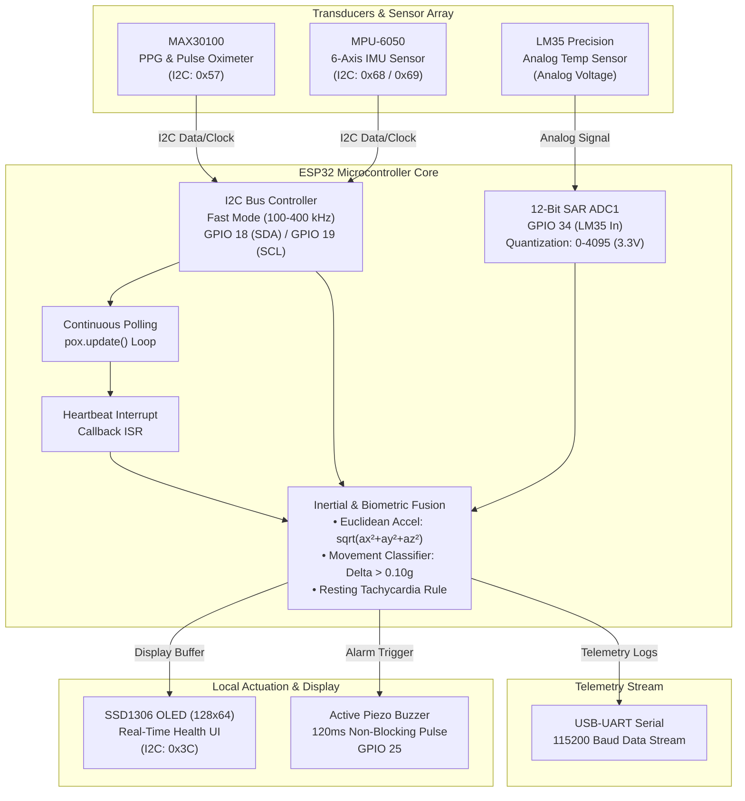

<div align="center">

# 🫀 AWEN: Adaptive Wellness & Emotional Navigation
### **ESP32-Based Embedded Health Monitoring System with Kinematic & Physiological Pattern Analysis**

[](https://www.espressif.com/)
[](https://isocpp.org/)
[](https://www.arduino.cc/)
[](docs/AWEN_Hardware_Synopsis.pdf)
[](media/)
[-3F51B5?style=for-the-badge)](https://www.aldel.edu.in/)

<p align="center">
  <b>Capstone Engineering Project (AF 52)</b><br>
  Department of Computer Science & Engineering (Data Science)<br>
  <b>St. John College of Engineering and Management (SJCEM), Palghar</b><br>
  <i>Affiliated with the University of Mumbai</i>
</p>

---

[🎥 Watch Demo Video](media/AWEN_Hardware_Demo_Video.mp4) • [📑 Hardware Synopsis (PDF)](docs/AWEN_Hardware_Synopsis.pdf) • [📊 Hardware Presentation](docs/presentations/AWEN_Hardware_Presentation_AF52.pptx) • [📊 Final Deck](docs/presentations/AWEN_Final_Presentation_AF52.pptx) • [⚡ Getting Started](#-getting-started--flashing-guide)

</div>

---

## 📋 Table of Contents
- [Executive Overview](#-executive-overview)
- [Key Architectural Highlights](#-key-architectural-highlights)
- [Demonstration & Lab Verification](#-demonstration--lab-verification)
- [Hardware Architecture & Data Flow](#-hardware-architecture--data-flow)
- [Hardware Interfacing & Pinout](#-hardware-interfacing--pinout)
- [Detection Algorithms & Decision Logic](#-detection-algorithms--decision-logic)
- [Firmware Implementation](#-firmware-implementation)
- [Getting Started & Flashing Guide](#-getting-started--flashing-guide)
- [Telemetry & Serial Monitor Output](#-telemetry--serial-monitor-output)
- [Project Documentation & Presentations](#-project-documentation--presentations)
- [Repository Structure](#-repository-structure)
- [Project Team & Mentorship](#-project-team--mentorship)
- [License & Acknowledgments](#-license--acknowledgments)

---

## 📌 Executive Overview

**AWEN (Adaptive Wellness & Emotional Navigation)** is a high-performance, embedded biometric telemetry and anomaly detection platform powered by the **ESP32 microcontroller**. Designed as a multimodal hardware monitoring edge-device, AWEN continuously acquires synchronized physiological vitals (photoplethysmography heart rate, peripheral capillary oxygen saturation $SpO_2$, precision core body temperature) alongside kinematic motion signatures (6-DoF inertial acceleration).

The system performs **edge-level sensory fusion** to distinguish genuine physiological distress (such as resting tachycardia or autonomic anomalies) from exertion-induced elevation, triggering autonomous acoustic alerts and rendering real-time telemetry on an integrated high-contrast OLED display without requiring external host compute.

```
       +-------------------------------------------------------------+
       |                       AWEN EDGE SYSTEM                      |
       |                                                             |
 [PPG Sensor]   -----\                                  /--> [OLED UI]
 [IMU 6-DoF]    ------> [ ESP32 Dual-Core Telemetry ]  ----> [Acoustic Alert]
 [LM35 Sensor]  -----/     (Real-Time Anomaly Engine)    \--> [UART Stream]
       +-------------------------------------------------------------+
```

---

## ⚡ Key Architectural Highlights

| Feature | Specification | Technical Implementation |
| :--- | :--- | :--- |
| **Photoplethysmography (PPG)** | Heart Rate (BPM) & $SpO_2$ (%) | **MAX30100** integrated pulse oximeter with active IR/Red LED driver (50 mA) and autonomous heartbeat interrupt detection. |
| **Precision Core Temperature** | Range: $0^\circ\text{C}$ to $100^\circ\text{C}$ ($10\text{ mV}/^\circ\text{C}$) | **LM35** linear analog thermal sensor wired to ESP32 ADC1 with 12-bit quantizer calibration and noise dampening. |
| **Kinematic Motion Profiling** | 6-Axis Inertial Tracking ($\pm 2g$) | **MPU-6050** MEMS accelerometer/gyroscope reading 3-axis acceleration vectors to compute Euclidean dynamic motion. |
| **Autonomous Anomaly Engine** | Dynamic Resting Tachycardia Alert | Evaluates biometric thresholds in tandem with inertial stillness ($\Delta a \le 0.10g$) to trigger targeted alerts. |
| **Edge Visualization** | 128x64 Mono Graphical Dashboard | **SSD1306** I2C OLED providing real-time BPM/SpO2 boxes, temperature, motion vector, beat indicator, and lock status. |
| **Acoustic Feedback** | Non-blocking Piezo Alarm | 120 ms pulsed tone alert on detected hemodynamic irregularities without stalling sensor polling. |
| **Telemetry Serialization** | 115200 Baud UART Pipeline | Formatted serial data logging facilitating downstream desktop ingestion, plotting, and cloud pipelines. |

---

## 📸 Demonstration & Lab Verification

### Working Hardware & Lab Authentication

| 🛠️ Team & Prototype Demonstration | 📍 Geo-Tagged Lab Verification |
| :---: | :---: |
|  |  |
| **AWEN Hardware Prototype & Dashboard Testing**<br>Team reviewing live OLED telemetry & serial acquisition. | **Mechanics Lab & Workshop, SJCEM Palghar**<br>Geo-coordinates: `Lat 19.705832° N, Long 72.783815° E` |

### 🎥 Working Prototype Demo Video
- 📹 **[Download / Watch Working Demo Video (MP4)](media/AWEN_Hardware_Demo_Video.mp4)** — Demonstrates sensor initialization, finger placement PPG detection, real-time OLED rendering, dynamic motion compensation, and acoustic buzzer trigger.

---

## 🧩 Hardware Architecture & Data Flow

The following Mermaid architectural diagram illustrates the sensor bus topology, edge compute routing, and telemetry output stages:



---

## 🛠️ Hardware Interfacing & Pinout

### Pin Allocation Matrix

| Module / Transducer | Pin / Signal | ESP32 GPIO | Operating Voltage | Protocol / Mode | Electrical Notes |
| :--- | :--- | :--- | :--- | :--- | :--- |
| **MAX30100** | SDA | `GPIO 18` | 3.3V | I2C Data (`0x57`) | Shared I2C bus; 4.7 kΩ pull-ups recommended |
| **MAX30100** | SCL | `GPIO 19` | 3.3V | I2C Clock | Shared I2C bus (100 kHz clock speed) |
| **MPU-6050** | SDA | `GPIO 18` | 3.3V | I2C Data (`0x68`) | Common bus with automatic fallback to `0x69` |
| **MPU-6050** | SCL | `GPIO 19` | 3.3V | I2C Clock | Common bus |
| **SSD1306 OLED** | SDA | `GPIO 18` | 3.3V | I2C Data (`0x3C`) | 128x64 pixels graphic buffer |
| **SSD1306 OLED** | SCL | `GPIO 19` | 3.3V | I2C Clock | Standard fast frame push |
| **LM35DZ** | $V_{\text{out}}$ | `GPIO 34` | 5.0V / 3.3V | Analog Input (ADC1) | $10\text{ mV}/^\circ\text{C}$ linear scaling; 0.1 µF bypass |
| **Active Buzzer** | Signal (+) | `GPIO 25` | 5.0V / 3.3V | Digital Push-Pull | Interfaced with 100 Ω current-limiting resistor |
| **System Ground** | GND | `GND` | Common | Common Ground | Essential zero-potential reference rail |

### Bill of Materials (BOM)

```
├── 1x ESP32 NodeMCU-32S / Dev Module (Dual Tensilica Xtensa 32-bit LX6)
├── 1x MAX30100 Optical Pulse Oximeter & Heart Rate Sensor Module
├── 1x MPU-6050 6-Axis Accelerometer & Gyroscope MEMS Module
├── 1x LM35DZ Precision Centigrade Temperature Sensor (TO-92 package)
├── 1x 0.96-inch Monochrome I2C OLED Display (SSD1306, 128x64 resolution)
├── 1x Active Piezoelectric Buzzer (5V/3.3V compatible)
├── 1x Half-size Solderless Breadboard & High-grade Dupont Jumper Leads
└── 1x Micro-USB High-Speed Data Cable
```

---

## 🧮 Detection Algorithms & Decision Logic

### 1. Dynamic Motion Vector Calculation
To reliably assess whether the subject is actively moving or stationary, the 3-axis accelerometer registers from the MPU-6050 are sampled and normalized into standard gravitational acceleration ($g$):

$$a_{\text{normalized}} = \sqrt{a_x^2 + a_y^2 + a_z^2} \quad \text{where } a_i = \frac{\text{raw}_i}{16384.0}$$

Dynamic movement status is inferred through instantaneous deviation from standard gravity ($1.0g$) and delta comparison:

$$\text{isMoving} = (\Delta a > 0.10g) \lor (|a_{\text{normalized}} - 1.0g| > 0.20g)$$

### 2. Context-Aware Resting Tachycardia Rule
Elevated heart rate ($> 105\text{ BPM}$) during physical exercise is a normal physiological response. However, high heart rate during prolonged inactivity indicates hemodynamic stress or panic events:

$$\text{Anomaly} = \begin{cases} 
\text{TRUE}, & \text{if } (SpO_2 > 80\%) \land (\text{HR} > 105\text{ BPM}) \land (\neg \text{isMoving}) \\ 
\text{FALSE}, & \text{otherwise} 
\end{cases}$$

Upon trigger, the firmware executes a non-blocking 120 ms acoustic alert cycle through the buzzer and flags the condition on both the OLED header (`ALT`) and serial pipeline.

---

## 💻 Firmware Implementation

The complete production firmware is located in [`esp32_health_monitor/esp32_health_monitor.ino`](esp32_health_monitor/esp32_health_monitor.ino).

### Core Firmware Architecture
- **Time-Sliced Execution**: High-rate sample polling for MAX30100 through uninhibited invocation of `pox.update()` in the primary execution loop.
- **Non-Blocking Alarm Timing**: Active buzzer timing managed via `millis()` state tracking ($t_{\text{pulse}} = 120\text{ ms}$) preventing main loop starvation.
- **Dynamic Address Auto-Discovery**: Automatic fallback between standard I2C addresses `0x68` and `0x69` for MPU-6050 sensor compatibility.
- **Sensor Drift Mitigation**: 12-bit ADC voltage normalization ($0 - 3300\text{ mV}$) with noise floor clamps for the LM35 thermal probe.

---

## 🚀 Getting Started & Flashing Guide

### 1. Prerequisites & Software Setup
- Install the latest **[Arduino IDE](https://www.arduino.cc/en/software)** (v2.0 or above).
- Add the ESP32 board package via **File > Preferences > Additional Boards Manager URLs**:
  ```text
  https://raw.githubusercontent.com/espressif/arduino-esp32/gh-pages/package_esp32_index.json
  ```
- Install required dependencies via **Sketch > Include Library > Manage Libraries...**:
  - `Adafruit SSD1306` (by Adafruit)
  - `Adafruit GFX Library` (by Adafruit)
  - `MAX30100lib` (by OXullo Intervent / PulseOximeter)
  - `Wire` (Standard ESP32 Core)

### 2. Clone the Repository
```bash
git clone https://github.com/diya-1720/CaPsToNe_HaRdWaRe.git
cd CaPsToNe_HaRdWaRe
```

### 3. Hardware Configuration & Flashing
1. Connect the ESP32 to your workstation via a Micro-USB data cable.
2. Open [`esp32_health_monitor/esp32_health_monitor.ino`](esp32_health_monitor/esp32_health_monitor.ino) in Arduino IDE.
3. Configure the target board settings:
   - **Board**: `ESP32 Dev Module`
   - **Upload Speed**: `921600` (or `115200` for legacy UART bridges)
   - **Flash Frequency**: `80MHz`
   - **Partition Scheme**: `Default 4MB with spiffs`
   - **Port**: Select the corresponding COM / ttyUSB port.
4. Click **Verify (✓)** to compile, followed by **Upload (➔)**.

---

## 📊 Telemetry & Serial Monitor Output

Open the Arduino Serial Monitor or any UART terminal at **115200 Baud**. Upon boot, the device reports sensor diagnostics followed by structured 1-second telemetry packets:

```text
[OK] MAX30100 Active
>>> BEAT DETECTED <<<
Temp: 36.8C | HR: 72 | SpO2: 98% | Accel: 1.01 g | Move: NO  | Buzzer: 0
Temp: 36.9C | HR: 74 | SpO2: 98% | Accel: 1.02 g | Move: NO  | Buzzer: 0
>>> BEAT DETECTED <<<
Temp: 37.1C | HR: 112 | SpO2: 97% | Accel: 0.99 g | Move: NO  | Buzzer: 1  <-- [ALERT: RESTING TACHYCARDIA]
Temp: 37.0C | HR: 108 | SpO2: 97% | Accel: 1.35 g | Move: YES | Buzzer: 0  <-- [EXERTION: MOVEMENT DETECTED]
```

---

## 📄 Project Documentation & Presentations

Comprehensive project reports, system architectures, and presentation slide decks are organized in the [`docs/`](docs/) directory:

- 📑 **Complete Project Synopsis Report**:  
  [`docs/AWEN_Hardware_Synopsis.pdf`](docs/AWEN_Hardware_Synopsis.pdf) *(Comprehensive 43-page technical specification, circuitry diagrams, sensor physics, and methodology)*
- 📊 **Hardware Architecture Presentation**:  
  [`docs/presentations/AWEN_Hardware_Presentation_AF52.pptx`](docs/presentations/AWEN_Hardware_Presentation_AF52.pptx) *(Detailed peripheral interfacing, I2C arbitration, timing analysis, and schematic layout)*
- 📊 **Final Project Review Presentation**:  
  [`docs/presentations/AWEN_Final_Presentation_AF52.pptx`](docs/presentations/AWEN_Final_Presentation_AF52.pptx) *(Final capstone presentation deck covering validation experiments, results, and team milestones)*

---

## 📂 Repository Structure

```text
CaPsToNe_HaRdWaRe/
├── .gitignore                                      # Build and temporary file exclusions
├── README.md                                       # Master technical documentation
├── docs/                                           # Academic documentation & presentations
│   ├── AWEN_Hardware_Synopsis.pdf                  # Complete 43-page hardware synopsis report
│   └── presentations/                              # Formal academic review slide decks
│       ├── AWEN_Final_Presentation_AF52.pptx       # Final Capstone Project defense deck
│       └── AWEN_Hardware_Presentation_AF52.pptx    # Hardware architecture review deck
├── media/                                          # Visual validation & demonstration assets
│   ├── AWEN_Hardware_Demo_Video.mp4                # Complete prototype working video
│   ├── AWEN_Team_GeoTagged.jpeg                    # Geo-tagged lab verification photograph
│   └── AWEN_Team_Prototype_Photo.jpeg              # Team with operational prototype & display
└── esp32_health_monitor/                           # Embedded firmware source tree
    └── esp32_health_monitor.ino                    # Production Arduino sketch for ESP32
```

---

## 👥 Project Team & Mentorship

### Student Engineering Team (Capstone AF 52)

| Student Name | Seat / Roll ID | Primary Capstone Focus & Contributions |
| :--- | :---: | :--- |
| **Diya Singh** | `EU1258014` | **Hardware Architecture Lead**: Circuit schematic design, I2C bus wiring, breadboard layout, and physical fabrication. |
| **Parth Topale** | `EU1258058` | **Firmware & Telemetry Lead**: Peripheral device drivers, non-blocking sample scheduler, UART output pipeline. |
| **Nishtha Lokhande** | `EU1258019` | **Verification & Probing Lead**: Electrical signal probing, ADC linearity tuning, sensor validation, and testing. |
| **Swara Patil** | `EU1258011` | **BOM & Documentation Lead**: Component acquisition, technical report curation, presentation deck formatting. |

### Project Guide & Institutional Affiliation
- **Project Mentor**: **Prof. Sachin Sase**  
  *Assistant Professor, Department of Computer Science & Engineering (Data Science)*  
- **Institution**: **St. John College of Engineering and Management (SJCEM)**  
  *Palghar, Maharashtra – 401404*  
  *Affiliated with the **University of Mumbai**, Approved by AICTE, Accredited with Grade 'A' by NAAC*

---

## 📜 License & Acknowledgments

This project is developed as an academic capstone engineering initiative under the Department of Computer Science & Engineering (Data Science) at SJCEM. Code and documentation are made accessible for academic research, peer review, and educational benchmarking.

Special thanks to the open-source hardware community, Espressif Systems, and the authors of the `MAX30100lib` and `Adafruit_SSD1306` libraries.

<div align="center">
  <sub>AWEN Hardware Monitoring System • Capstone AF 52 • St. John College of Engineering and Management</sub>
</div>
