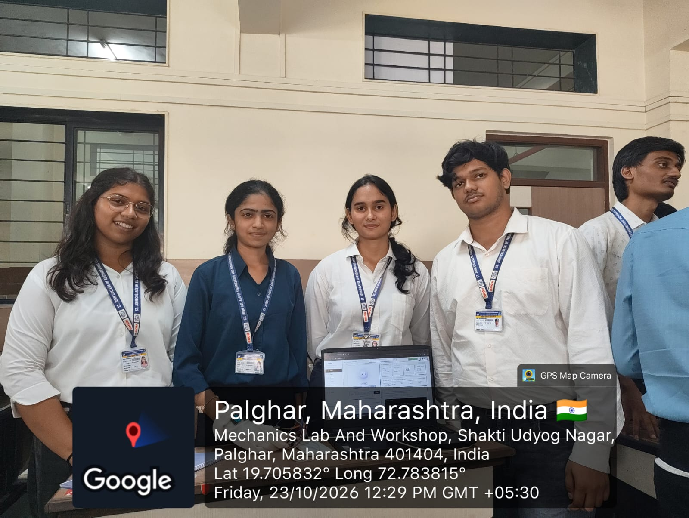
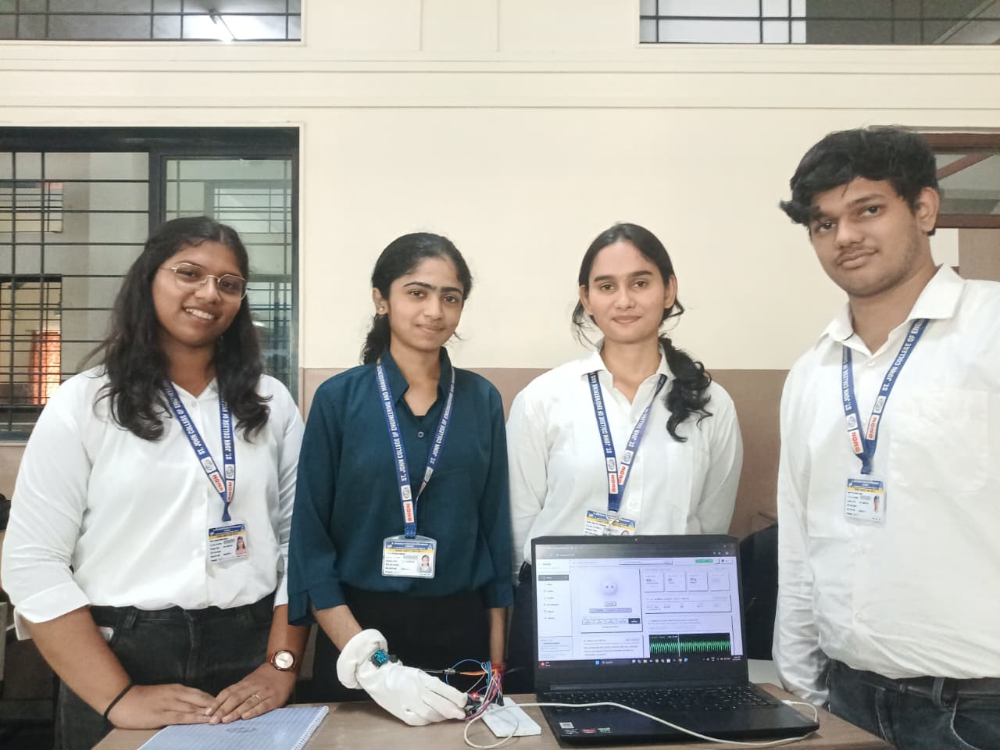

# AWEN: Adaptive Wellness & Emotional Navigation (Hardware)

> **ESP32-Based Health Monitoring System with Physiological and Behavioural Patterns**  
> *Capstone Project (AF 52) – Department of Computer Science & Engineering (Data Science)*  
> *St. John College of Engineering and Management (SJCEM), University of Mumbai*

---

## 📸 Project Demonstration & Media

| Team & Prototype Demonstration | Geo-Tagged Lab Verification |
| :---: | :---: |
|  |  |
| *Team with the ESP32 Hardware Prototype & Live Dashboard* | *Mechanics Lab & Workshop, SJCEM, Palghar (Lat 19.705832°, Long 72.783815°)* |

### 🎥 Working Prototype Demo Video
- 📹 **[Watch AWEN Hardware Working Demo Video (MP4)](media/AWEN_Hardware_Demo_Video.mp4)**

---

## 📄 Project Documentation & Presentations

All project documentation, report PDFs, and slide decks are organized in the [`docs/`](docs/) directory:
- 📑 **Hardware Synopsis Report**: [AWEN Hardware Synopsis Report (PDF)](docs/AWEN_Hardware_Synopsis.pdf) *(Complete 43-page specification)*
- 📊 **Hardware Architecture Presentation**: [AWEN Hardware Presentation (PPTX)](docs/presentations/AWEN_Hardware_Presentation_AF52.pptx)
- 📊 **Final Project Presentation Deck**: [AWEN Final Presentation (PPTX)](docs/presentations/AWEN_Final_Presentation_AF52.pptx)

---

## 📌 Overview

**AWEN (Adaptive Wellness & Emotional Navigation)** is an integrated embedded monitoring and data-handling system developed around the **ESP32 microcontroller**. It captures multi-channel physiological and kinematic signals in real time, provides autonomous on-device visual and acoustic feedback, and streams telemetry via a USB-UART serial pipeline for desktop visualization and local persistence.

### Key Capabilities
- **Heart Rate (BPM) & Blood Oxygen Saturation (SpO2)**: Real-time photoplethysmography (PPG) via the **MAX30100** optical sensor.
- **Precision Body Temperature**: Linear analog temperature measurement using the **LM35** sensor with multi-sample filtering.
- **Kinematic Motion Tracking**: 6-axis acceleration and angular velocity tracking via the **MPU6050** to distinguish resting states from active physical motion.
- **Autonomous Anomaly Alerting**: Intelligent resting tachycardia detection (High BPM when motionless) triggering an active **piezo buzzer** alarm.
- **On-Device Graphical Dashboard**: High-contrast real-time display on a 0.96" **SSD1306 OLED** (128x64) showing BPM, SpO2, Temperature, Motion, and alert status without requiring a PC connection.

---

## 🛠️ Hardware Interfacing & Pinout

| Module / Sensor | Bus / Signal Type | ESP32 Pin | Description |
| :--- | :--- | :--- | :--- |
| **I2C Bus (Shared)** | SDA (Data) | **GPIO 18 / 21** | Shared I2C data line (MAX30100 `0x57`, MPU6050 `0x68`, OLED `0x3C`) |
| **I2C Bus (Shared)** | SCL (Clock) | **GPIO 19 / 22** | Shared I2C clock line (400 kHz Fast-Mode with 4.7 kΩ pull-ups) |
| **LM35 Temp Sensor** | Analog Voltage | **GPIO 36 / 34** | ADC1 input (10.0 mV/°C linear scale with 0.1 µF bypass) |
| **Active Buzzer** | Digital Output | **GPIO 25** | Acoustic alert signal via 100 Ω current-limiting resistor |
| **Power Supply** | Dual Rail | **3.3V & 5V / VIN**| 3.3V for digital sensor ICs/OLED; 5V for LM35 & Buzzer |

---

## 📦 Required Arduino Libraries

Ensure the following libraries are installed in Arduino IDE (**Sketch > Include Library > Manage Libraries...**):
1. **Adafruit SSD1306**
2. **Adafruit GFX Library**
3. **MAX30100lib** (by OXullo Intervent / PulseOximeter)
4. **Wire** (Standard ESP32 Core)

---

## 🚀 Getting Started

1. **Clone the Repository**:
   ```bash
   git clone https://github.com/diya-1720/CaPsToNe_HaRdWaRe.git
   ```
2. **Open the Firmware**:
   Open [`esp32_health_monitor/esp32_health_monitor.ino`](esp32_health_monitor/esp32_health_monitor.ino) in Arduino IDE.
3. **Configure Board**:
   - Board: **ESP32 Dev Module**
   - Upload Speed: **921600** (or **115200**)
   - Select the connected COM port.
4. **Upload & Monitor**:
   - Compile and flash the sketch.
   - Open Serial Monitor at **115200 baud** for live telemetry logs.

---

## 📂 Repository Structure

```text
CaPsToNe_HaRdWaRe/
├── .gitignore
├── README.md
├── docs/
│   ├── AWEN_Hardware_Synopsis.pdf             # Complete Project Synopsis Report
│   └── presentations/
│       ├── AWEN_Final_Presentation_AF52.pptx   # Final Presentation Slide Deck
│       └── AWEN_Hardware_Presentation_AF52.pptx# Hardware Architecture Presentation
├── media/
│   ├── AWEN_Team_GeoTagged.jpeg               # Geo-tagged Team Photo (Mechanics Lab)
│   ├── AWEN_Team_Prototype_Photo.jpeg         # Team & Prototype Hardware Photo
│   └── AWEN_Hardware_Demo_Video.mp4           # Prototype Working Video
└── esp32_health_monitor/
    └── esp32_health_monitor.ino               # ESP32 Arduino Firmware
```

---

## 👥 Project Team & Mentorship

- **Diya Singh** (EU1258014) – *Hardware Architecture Lead & Circuit Assembly*
- **Parth Topale** (EU1258058) – *Firmware Drivers & Peripheral Control Lead*
- **Nishtha Lokhande** (EU1258019) – *Electrical Verification & Probing Lead*
- **Swara Patil** (EU1258011) – *BOM Management & Technical Documentation Lead*

**Project Guide**: **Prof. Sachin Sase**  
*Assistant Professor, Department of Computer Science & Engineering (Data Science)*  
*St. John College of Engineering and Management (SJCEM), Palghar*
